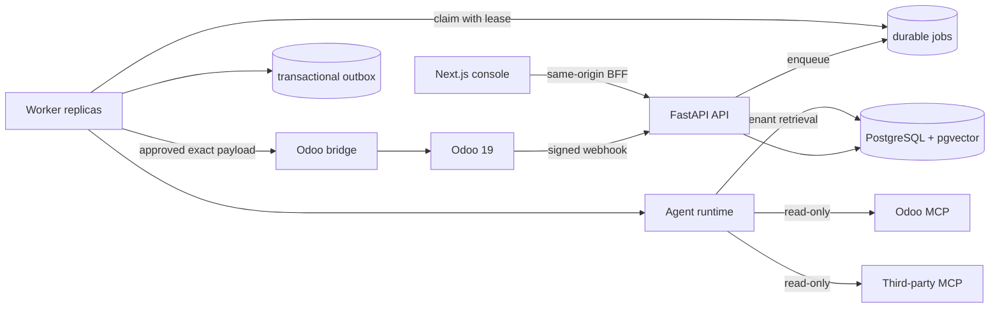

# System architecture

## Design objective

FlowPilot places probabilistic reasoning inside a deterministic control plane. The model may choose
which read tools to call and how to explain a case. It may not bypass tenant isolation,
authorization, durable approval, idempotency, the write allowlist, or the worker state machine.



## Components

### Next.js web and backend-for-frontend

The customer-facing console presents the case queue, commercial exposure, evidence-backed analysis,
immutable action payloads, approvals, integration health, and usage. Browser requests go through a
same-origin Next.js route. Demo or OIDC credentials are added server-side rather than embedded in the
client bundle.

### FastAPI API

The API owns authentication, tenant context, command validation, idempotency, synchronous reads,
webhook verification, and durable state creation. An investigation request returns a job; model work
is not kept alive inside the HTTP request.

### PostgreSQL and pgvector

PostgreSQL is the source of truth and coordination plane. It stores cases, events, agent runs,
conversation memory, documents/vectors, inbox/outbox events, jobs, approvals, and usage. Application
queries are tenant-scoped, and the migration forces row-level security on tenant-owned tables.
SQLite plus deterministic embeddings is the zero-key local path.

### Worker

Workers claim jobs with leases. PostgreSQL uses `FOR UPDATE SKIP LOCKED` when available, permitting
multiple workers to claim independent work. Expired leases can be retried. Each side effect carries
an idempotency key.

### Agent runtime

The baseline is one agent with a coherent objective. It has:

- tenant-scoped case retrieval;
- tenant-scoped SOP retrieval;
- read-only Odoo MCP tools;
- an optional allowlisted third-party MCP server;
- a local function that stages, but never executes, an action proposal.

The live path uses the OpenAI Agents SDK, Pydantic structured output, application-owned tenant memory,
OpenAI Responses compaction, tracing, token/turn/time budgets, and a severity-based model router. The
deterministic runtime exercises the same business boundary without an API key.

### MCP boundary

`flowpilot.odoo_mcp.server` exposes four business-level read tools rather than arbitrary Odoo
model/method access. `flowpilot.supplier_mcp.server` is a local simulator for a separately owned
supplier system. The local Compose network is the security boundary; production must enforce MCP
authentication at the server or gateway using OAuth, workload identity, mTLS, and network policy.
An Authorization header sent by the client is not, by itself, proof that a server validates it.

### Odoo bridge

Odoo JSON-2 calls each run in their own transaction. The optional addon therefore exposes one custom
method for each approved logical action. It validates an allowlisted action, takes a PostgreSQL
advisory transaction lock on the idempotency key, executes under a dedicated Odoo bot user without
`sudo()`, and stores a durable receipt. FlowPilot verifies the approval signature before making this
call; Odoo separately enforces ACLs and record rules.

## Core flow

```mermaid
sequenceDiagram
  participant U as Operator
  participant API as FastAPI
  participant DB as PostgreSQL
  participant W as Worker
  participant A as Agent
  participant O as Odoo

  U->>API: Start investigation + client request ID
  API->>DB: Insert idempotent job
  API-->>U: 202 Job
  W->>DB: Claim job with lease
  W->>A: Run bounded investigation
  A->>O: Read through MCP
  A->>DB: Retrieve tenant SOPs
  A-->>W: Structured answer + action draft
  W->>DB: Persist run, evidence, exact proposal
  U->>API: Approve expected payload hash
  API->>DB: Lock row; store signature + execution job
  W->>DB: Recompute hash and verify signature
  W->>O: Execute allowlisted exact payload
  O-->>W: Durable/idempotent receipt
  W->>DB: Persist result + outbox event
```

## Correctness invariants

1. Every business query is tenant-scoped; PostgreSQL RLS is a second boundary.
2. The model cannot directly invoke an Odoo write tool.
3. Approval binds organization, case, tool, target, complete payload, and expiration through a hash.
4. The worker recomputes that hash and verifies the HMAC authorization before execution.
5. At-least-once delivery must not become duplicate side effects.
6. Browser lifetime does not control workflow lifetime.
7. Retrieved and third-party text is evidence, never policy.
8. External network calls are not made while holding long product-database transactions.
9. Agent memory is ordinary tenant data created by migrations, not runtime DDL.

## Scaling axes

| Pressure | Independent control |
|---|---|
| HTTP reads and commands | API replicas, connection pool, HPA |
| Agent/Odoo latency | worker replicas, leases, per-tenant concurrency |
| Queue backlog | worker count or external queue adapter |
| Database connections | small pools, replica caps, PgBouncer/RDS Proxy |
| Retrieval volume | bounded top-k, pgvector indexes, corpus lifecycle |
| Noisy tenants | quotas, fair scheduling, model/cost budgets |
| Provider limits | bounded retries, routing, circuit breaking |

## Why a modular monolith plus workers

The API, worker, and MCP processes have materially different scaling, permission, and failure
properties, so they are separate deployables. Domain logic remains one Python package while product
semantics are evolving. Kafka, Redis, and additional microservices should be introduced only when a
measured bottleneck or ownership boundary justifies them.
